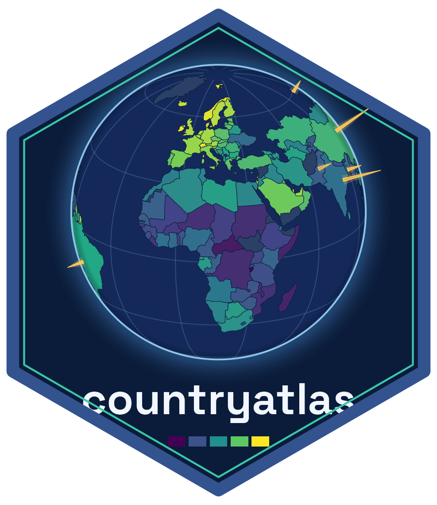

<!-- README.md is generated from README.Rmd. Please edit that file -->

```{r, include = FALSE}
knitr::opts_chunk$set(collapse = TRUE, comment = "#>", dpi = 110,
                      fig.path = "man/figures/README-", out.width = "100%")
```

# countryatlas 

<!-- badges: start -->
[](https://CRAN.R-project.org/package=countryatlas)
[](https://github.com/PursuitOfDataScience/countryatlas/actions/workflows/R-CMD-check.yaml)
<!-- badges: end -->

**Country data from any source, joined on ISO codes and drawn as equal-area maps that state their coverage and source.**

🔑 **One key for every spelling**, in a dozen languages:

```{r}
library(countryatlas)
d <- data.frame(country = c("Cote d'Ivoire", "Korea, Rep.", "Deutschland", "U.K."))
standardize_country(d, country, add = "iso3c")
```

🗺️ **An equal-area map** with its coverage and source in the caption:

```{r map, fig.height = 3.4, fig.width = 8, fig.alt = "World map of GDP per capita in five quantile classes, Equal Earth projection, with a caption giving coverage and source."}
world_map(attach_geometry(world_snapshot$countries), gdp_per_capita)
```

🕰️ **Memberships and income groups as of any date**, row by row:

```{r}
in_group(c("GBR", "GBR"), "EU", origin = "iso3c", as_of = c(2016, 2021))
classify_countries(data.frame(iso3c = "VNM", year = c(2026, 2027)), "income")
```

## 🚀 Setup

1. `install.packages("countryatlas")`
2. `library(countryatlas)`: the bundled `world_snapshot` and every map work offline, in Equal Earth.
3. For the `sf` backend and every other projection: `install.packages(c("sf", "rnaturalearth", "rnaturalearthdata"))`
4. Live data: `world_data(2020)` from the World Bank, or any provider in `country_sources()` through `fetch_indicator()`.

- 💡 To reproduce a figure exactly, pin the World Bank release: `world_data(2020, vintage = "2024-07")`.
- 💡 Downloads are cached in `tools::R_user_dir("countryatlas", "cache")`; `clear_country_cache()` empties it.
- 💡 Fetching through a proxy: point `CURL_CA_BUNDLE` at your organisation's certificate bundle.

## 📚 Learn more

The [Gallery](https://pursuitofdatascience.github.io/countryatlas/articles/gallery.html)
shows every map verb; the articles cover [panels](https://pursuitofdatascience.github.io/countryatlas/articles/panels.html),
[tracing data to its source](https://pursuitofdatascience.github.io/countryatlas/articles/data-you-can-trace.html)
and [honest maps](https://pursuitofdatascience.github.io/countryatlas/articles/honest-maps.html).
